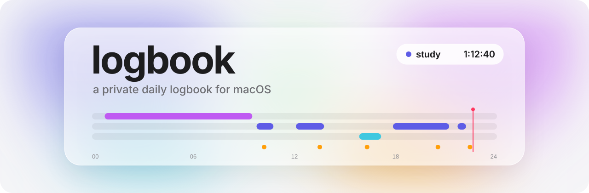
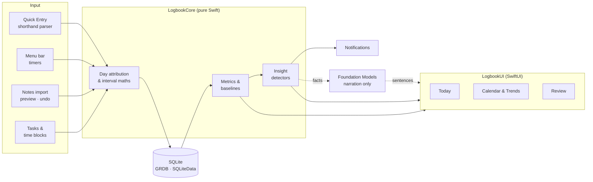

<div align="center">

<picture>
  <source media="(prefers-color-scheme: dark)" srcset="docs/assets/banner-dark.svg">
  
</picture>

<br/>

**Work, food, sleep and energy — logged in seconds, understood over months.**

<sub>A native macOS app that replaces a daily Apple Notes log with live timers, to-dos, a time-blocking calendar, real metrics, beautiful charts and gentle, proactive nudges.</sub>

<br/>


[**Master plan**](docs/MASTER_PLAN.md) &nbsp;·&nbsp; [**Research**](docs/research/stack-and-architecture-report.md) &nbsp;·&nbsp; [**Roadmap**](#roadmap) &nbsp;·&nbsp; [**Architecture**](#architecture)

</div>

---

## Why

Every day gets logged by hand: work blocks, what was eaten (with calories, protein and caffeine), calories burnt, nature's-call blocks and sleep. In Notes that means typing totals by hand and never seeing the patterns. **logbook** keeps the same fast shorthand, then does the arithmetic, draws the trends and speaks up when something is worth noticing.

> [!NOTE]
> This is a personal app for one person on one Mac. It is not distributed, has no accounts, no server and no telemetry. Everything stays on the machine.

## What it logs

| | Domain | You type | logbook computes |
|:-:|---|---|---|
| 🟣 | **Sleep** | `sleep 0045-0930` | duration, onset, wake, midpoint, regularity |
| 🔵 | **Work** | `0945-1045 study` | daily total, per project, deep-work blocks, first start, streaks |
| 🟠 | **Food** | `pulao 250g - 408 / 8 / 0` | calories, protein, caffeine, caffeine still in your system |
| 🟢 | **Energy** | `burn 373 11773` | calories burnt, steps, net calories |
| 🩵 | **Nature's call** | `nc 1550-1708` | count, minutes, time-of-day pattern |
| ✅ | **To-dos** | `t write deck ~45m !! fri` | due and scheduled tasks, actual time vs estimate |
| 🗓 | **Time blocks** | `plan 1400-1600 deep work` | plan vs actual, adherence, start-time drift |

Anything else (weight, water, gym, mood, …) can be added later as a **custom metric** and automatically gets logging, charts, baselines and insights.

## Highlights

<table>
<tr>
<td width="50%" valign="top">

### ⚡️ Faster than Notes
A global **Quick Entry** field (⌥Space) that understands your existing shorthand and shows a live parsed preview before saving. A **⌘K** command palette, recent and favourite foods, "copy yesterday", and an evening **Close the day** sheet that finds the gaps.

</td>
<td width="50%" valign="top">

### ⏱ Live timers everywhere
Start a block and it ticks in the **menu bar**. Timers are stored as start times, so quitting, crashing or sleeping the Mac never loses a second, and a forgotten timer politely asks if you're still going.

</td>
</tr>
<tr>
<td valign="top">

### 📈 Metrics that compare you with you
Every number is shown against **your own 7- and 28-day baseline**, with a plain-English headline: *"6 h 10 m, 40 m above your 4-week average."* No scores, no red/green guilt.

</td>
<td valign="top">

### 🔮 Proactive, not noisy
An insight engine with real statistical safeguards (minimum data, confidence and false-discovery control) produces at most **3 cards a day**: late-caffeine warnings tied to *your* bedtime, sleep-vs-work patterns, trend shifts and personal bests.

</td>
</tr>
<tr>
<td valign="top">

### 🎨 Native and premium
SwiftUI with **Liquid Glass**, Swift Charts, SF Symbols, spring animations and tabular numerals. One colour per domain, everywhere, in light and dark.

</td>
<td valign="top">

### 🔒 Your history is sacred
Local SQLite, daily automatic backups, full JSON/CSV export, and every imported row keeps its original text. Imports preview first and can be undone.

</td>
</tr>
<tr>
<td valign="top">

### ✅ To-dos that know about time
Lists, Inbox, Today and Upcoming, with estimates, due dates and recurrence. Hit **Start** on a task and its timer runs; every task shows actual time against its estimate.

</td>
<td valign="top">

### 🗓 Time blocking, plan vs actual
Drag tasks onto a day or week **calendar** to block time, stamp an "ideal day" template, then see what you planned ghosted behind what actually happened. Apple Calendar events can sit alongside, read-only.

</td>
</tr>
</table>

## Screens

```
┌────────────────┬─────────────────────────────────────────────────────────────────┐
│  Today         │  WORK 6h 30m   NET 1,243 kcal   PROTEIN 102 g   CAFFEINE 38 mg  │
│  Calendar      │  ─────────────────────────────────────────────────────────────  │
│  Tasks         │  sleep  ▓▓▓▓▓▓▓▓▓▓▓                                             │
│  Work          │  work               ▓▓   ▓▓▓        ▓▓▓▓▓▓  ▓                   │
│  Food          │  nc                            ▓▓                               │
│  Sleep         │  food               •    •     •         •    •   │ now         │
│  Body          │  ─────────────────────────────────────────────────────────────  │
│  Trends        │  ◆ Last caffeine is within 6 h of your usual sleep time         │
│  Review        │  ◆ Longest deep-work day in 6 weeks                             │
│  Library       │                                                                 │
└────────────────┴─────────────────────────────────────────────────────────────────┘
```

**Today** · **Calendar** (day / week / month, plan vs actual) · **Tasks** · **Work** · **Food** · **Sleep** · **Body** · **Trends** · **Review** (weekly and monthly reports) · **Library** (foods, categories, custom metrics, goals) · **Import / Export** · **Settings**, plus the **menu bar timer**, **Quick Entry** and the **command palette**.

## Stack

| Layer | Choice |
|---|---|
| Language | **Swift 6.4**, Swift 6 language mode, nothing else |
| UI | **SwiftUI** with Liquid Glass, small AppKit bridges where needed |
| Charts | **Swift Charts** |
| Storage | **SQLite** via [GRDB](https://github.com/groue/GRDB.swift) 7.12 and [SQLiteData](https://github.com/pointfreeco/sqlite-data) 1.12, sync-ready schema |
| Architecture | `@Observable` services, pure logic in local Swift packages, injected clock and calendar |
| On-device AI | Apple **Foundation Models**, only to phrase numbers Swift has already computed |
| Project | Xcode 27.2 JSON project (`project.xcproj`), edited via `xcrun xcodeproj` |
| Tests | Swift Testing, snapshot tests for views |

Why this and not SwiftData, Tauri, Electron or Flutter? See the [research report](docs/research/stack-and-architecture-report.md).

## Architecture



```
logbook/
├── Logbook.xcodeproj/        JSON project, edited only via `xcrun xcodeproj`
├── App/                      entry point, menu bar, windows, assets, icon
├── Packages/
│   ├── LogbookCore/          types, interval maths, attribution, metrics, insights
│   ├── LogbookPersistence/   schema, migrations, queries, backup/export
│   ├── LogbookImport/        shorthand parser, import plan, `logbook-import` CLI
│   └── LogbookUI/            design system and feature views
├── Fixtures/                 real log snippets for golden tests
└── docs/                     master plan, research, design notes
```

## Roadmap

| | Milestone | Outcome |
|:-:|---|---|
| ✅ | **Research & plan** | Stack chosen, [master plan](docs/MASTER_PLAN.md) written |
| 🟡 | **M0 · Spike** | Ad-hoc build runs; live DB opens; menu bar timer ticks (via `NSStatusItem`). Permission-survival checks need a manual pass ([checklist](docs/M0_SPIKE.md)) |
| ✅ | **M1 · Foundation** | Schema, day attribution (calendar day) and `daily_facts`; date-maths matrix passing |
| 🟡 | **M2 · Import history** | Importer built: preview, undo, food library seeding ([format](docs/IMPORT_FORMAT.md)). Waiting for the real logs |
| ⬜️ | **M3 · Daily driver** | Today, Quick Entry, timers, menu bar, Close the day; **Notes retired** |
| ⬜️ | **M4 · Food** | Library, favourites, meals, caffeine curve, protein tracking |
| ⬜️ | **M5 · Charts & trends** | Calendar (actual layer), Work, Sleep, Body and Trends screens with baselines |
| ⬜️ | **M6 · Plan** | To-do lists, time-blocking calendar, templates, plan vs actual, Apple Calendar overlay |
| ⬜️ | **M7 · Proactive** | Insight engine, capped notifications, weekly review |
| ⬜️ | **M8 · Polish** | Design pass, motion, icon, keyboard, accessibility, backups |
| ⬜️ | **M9 · AI recap** | On-device daily and weekly prose with template fallback |
| ⬜️ | **M10 · Everywhere on the Mac** | Shortcuts and Spotlight actions, launch at login, custom metrics UI |
| 💭 | **Later** | Widgets · iPhone/Watch quick log · Health import · iCloud sync |

## Principles

1. **Faster than Notes, or it fails.**
2. **The app does the maths.** You never type a total again.
3. **Compare you with you.** Baselines, not scoreboards.
4. **Proactive, not noisy.** Few, earned, explainable insights.
5. **Your history is sacred.** Local, backed up, exportable, undoable.
6. **Native, not imitated.** Real SwiftUI, real glass.
7. **Built to grow.** New metrics and features without rewriting the core.
8. **Plan, then compare.** What you planned beside what happened, never a guilt trip.

## Building

> [!NOTE]
> The app is currently the M0 spike window plus the data layer and importer. Opening it in Xcode asks once to "Trust & Enable" the package macros.

Requirements: macOS 27, Xcode 27.2, Apple silicon. No paid Apple Developer account needed for the Mac app.

```bash
make build     # xcodebuild, Debug
make run       # build and open
make test      # swift test for every package
make install   # Release build to /Applications/Logbook.app
make format-check  # project.xcproj is in canonical form
make import-preview FILE=data/notes.md   # then import-apply; see docs/IMPORT_FORMAT.md
```

## Docs

- 📘 [Master plan](docs/MASTER_PLAN.md): data model, screens, metrics, to-dos and time blocking, proactive layer, roadmap, open decisions
- 🔬 [Stack & architecture research](docs/research/stack-and-architecture-report.md): why Swift, SwiftUI and SQLite, with sources
- 🗂 [Research notes](docs/research/notes/): persistence, Apple platform features, cross-platform alternatives, UX patterns, insight engine, engineering patterns, build tooling

<div align="center">
<br/>
<sub>Built for one person, with care. Private, local, and entirely mine.</sub>
</div>
